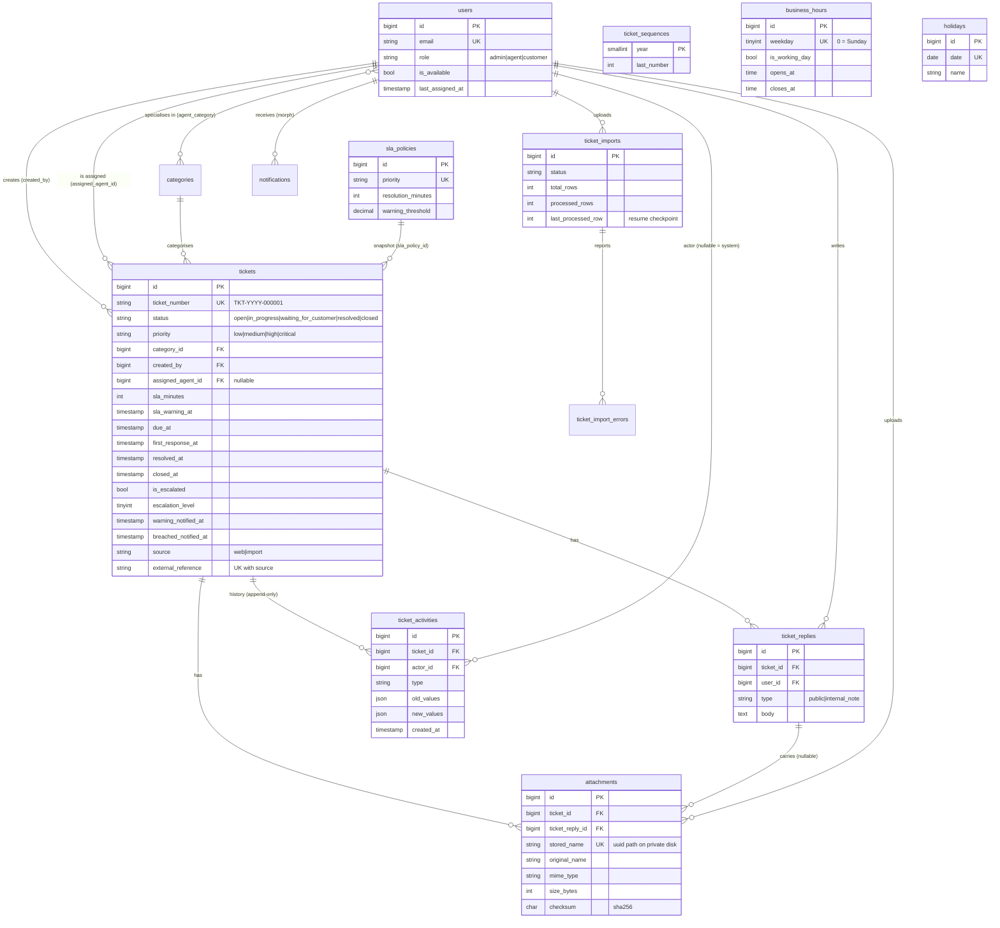

# Architecture

A conventional Laravel 12 monolith (Blade + Alpine), with business logic in single-purpose **Actions** and reusable
**Services**. Controllers stay thin: they authorize, validate through a FormRequest, call one Action and return a
response.

## Layers

```
            ┌──────────────────────────── HTTP ────────────────────────────┐
 Browser ──►│ Middleware: web (session, CSRF, cookies) · SecurityHeaders     │
            │             auth · verified · role:* · throttle:*            │
            │ Route model binding: {ticket} → Ticket::visibleTo($user)      │
            ├──────────────────────────────────────────────────────────────┤
            │ Controller (thin)  ── FormRequest (validate)                  │
            │                    ── Policy / Gate ($this->authorize)        │
            │                    ── Action (one use case)                   │
            │                    ── View / Resource / redirect              │
            └──────────────────────────────────────────────────────────────┘
                     │
                     ▼
 Actions (app/Actions/{Tickets,Replies,Assignment,Sla,Imports})
   · own the DB::transaction boundary, row locks and compare-and-set writes
   · record activities, dispatch events (after commit)
                     │
                     ▼
 Services (app/Services/…)           Support (app/Support/…)
   · Sla: BusinessCalendar (pure),     · FullTextQuery, SafeFilename,
     BusinessHoursSlaCalculator,         FileSize, BusinessTime, Csv
     SlaPolicyRepository (cached),
     SlaStatusResolver, TicketSlaRecalculator
   · Assignment: strategies, CandidateAgents
   · TicketNumberGenerator, TicketActivityRecorder
   · Dashboard: DashboardStatsService (cached aggregates)
                     │
                     ▼
 Models (Eloquent): relationships, enum casts, scopes (visibleTo, active, slaStatus, search …)
                     │
                     ▼
 MySQL 8 (InnoDB, FULLTEXT) · Redis (queue, cache, locks) · private disk (attachments, imports)

 Async: Events ─► queued Listeners ─► Notifications (mail + database)
        Scheduler (routes/console.php) ─► Commands ─► Jobs ─► Actions
```

| Layer | May call | Must not |
|---|---|---|
| Controller | FormRequest, Policy, Action, read queries for the view | contain business rules or multi-step writes |
| Action | Services, Models, events, `DB::transaction` | read the HTTP request or session |
| Service | Models, config | return HTTP responses, call Actions |
| Listener / Job | Actions, Services, Notifications | assume it runs inside the request |
| Model | relationships, casts, scopes | call Actions or send notifications |

Architecture tests (`tests/Unit/ArchitectureTest.php`, `Notifications/NotificationDeliveryTest.php`) enforce these:

- no debug calls;
- listeners are queued and run after commit;
- every notification is queued.

## Request lifecycle: "create ticket"

```
POST /tickets  (customer)
 │
 ├─ web middleware: session, CSRF token check, SecurityHeaders (CSP nonce)
 ├─ auth, verified
 ├─ throttle:tickets            10 per minute per user, else 429
 │
 ├─ TicketController@store
 │    ├─ StoreTicketRequest     subject, description, priority (enum), active category, attachments
 │    │                         (whitelisted extension + sniffed content type, size, count)
 │    ├─ authorize('create', Ticket::class)       TicketPolicy
 │    └─ CreateTicket($user, $data, $files)
 │
 ├─ CreateTicket ─ DB::transaction ───────────────────────────────────────────────┐
 │    1. TicketNumberGenerator::generate()                                         │
 │         INSERT IGNORE ticket_sequences(year); SELECT … FOR UPDATE; +1           │
 │         → TKT-2026-000042 (the counter rolls back with the ticket: no gaps)     │
 │    2. BusinessHoursSlaCalculator::calculate(priority, now)                      │
 │         policy + BusinessCalendar (cached) → sla_minutes, sla_warning_at, due_at│
 │    3. INSERT tickets (status open, UTC timestamps)                              │
 │    4. TicketActivityRecorder → ticket_activities "ticket_created"               │
 │    5. StoreAttachments → private disk tickets/{id}/{Y}/{m}/{uuid}.ext + rows    │
 │    6. TicketCreated::dispatch()      (ShouldDispatchAfterCommit)                │
 │    7. AutoAssignTicket::dispatch()->afterCommit()                               │
 │    ── COMMIT ── (a failure rolls everything back and deletes the stored files)  │
 │                                                                                 │
 ├─ redirect to /tickets/TKT-2026-000042 with a flash message ◄────────────────────┘
 │
 └─ after commit (queue workers):
      NotifyTicketCreated      → customer "We received your ticket"
                               → admins + agents of the category "New ticket: …"
      AutoAssignTicket (unique per ticket)
         transaction: lock candidate agents FOR UPDATE (id order) → strategy picks
         → ClaimTicket guarded UPDATE (assigned_agent_id IS NULL) → activity "assigned"
         → TicketAssigned ─► NotifyTicketAssigned → agent + customer
```

Errors: validation sends the user back with messages. A failed write is logged with context, and the user sees a
friendly message (database errors carry a reference id, `bootstrap/app.php`). Nothing is swallowed.

## Event flow

| Event (after commit) | Raised by | Queued listener → effect |
|---|---|---|
| `TicketCreated` | `CreateTicket` | `NotifyTicketCreated` → customer confirmation; admins and category agents alerted |
| `TicketAssigned` | `ClaimTicket`, `AssignTicket` | `NotifyTicketAssigned` → agent (unless they took it themselves) and customer |
| `TicketReleased` | `ReleaseTicket` | (activity only; the ticket returns to the queue) |
| `TicketUpdated` | `UpdateTicket` | (activity per changed field; priority change → SLA recalculated) |
| `TicketStatusChanged` | `ChangeTicketStatus` | (activity; drives dashboards) |
| `TicketResolved` | `ResolveTicket` | `NotifyTicketResolved` → customer |
| `TicketReopened` | `ChangeTicketStatus` (reopen) | (activity; SLA restarted from the reopen time) |
| `ReplyAdded` | `AddReply` | `NotifyReplyAdded` → public agent reply → customer; customer reply → assignee or admins; internal note → staff only, **never** the customer |
| `SlaWarningReached` | `EscalateTicket` (warning) | `NotifySlaWarning` → assignee or admins |
| `SlaBreached` | `EscalateTicket` (breach) | `NotifySlaBreached` → assignee + admins; unassigned → `AutoAssignTicket` |
| `TicketEscalated` | `EscalateTicket` (level 2) | `NotifyTicketEscalated` → admins |

```
sla:scan (every minute, onOneServer, withoutOverlapping)
   ├─ approaching & warning_notified_at IS NULL ──► EscalateTicketJob(warning)  ┐ unique per
   ├─ breached    & breached_notified_at IS NULL ─► EscalateTicketJob(breach)   │ ticket+kind
   └─ escalated level 1 & due ≤ now − 120 min ───► EscalateTicketJob(level2)    ┘
                                                        │
                                   guarded UPDATE … WHERE warning_notified_at IS NULL
                                   (0 rows ⇒ someone already did it ⇒ stop: idempotent)
                                                        │
                                   activity + event ──► queued notifications (mail queue: notifications)
```

## Data model



Indexes and their justification: [PERFORMANCE.md](PERFORMANCE.md) and DECISIONS (Database).

## Cross-cutting

- **Configuration:** every business setting is in `config/support.php` (env-backed); rules admins can change
  (SLA targets, hours, holidays) live in tables and are cached.
- **Time:** stored in UTC; converted to `SUPPORT_TIMEZONE` only in the SLA calendar and in views (`BusinessTime`).
- **Transactions:** every multi-step write is one `DB::transaction` inside its Action; events and jobs dispatch
  after commit, so nothing fires for a rollback.
- **Errors:** exceptions are never swallowed. They are logged with ticket and user context
  (`bootstrap/app.php` adds context to every report). Domain errors (`InvalidTicketTransition`,
  `AssignmentConflict`, `ReplyNotAllowed`) render friendly 409/422 responses. Every log entry at error
  level or above, which includes every reported exception, also goes to the `tracker` channel
  (`ErrorTrackerHandler` → `ErrorRecorder` → `error_logs`). `TrackHttpErrors` adds 4xx responses, and admins
  review everything, grouped, at `/admin/errors`. Visitors get custom error pages with a reference number
  (D-130).
- **Strict Eloquent** outside production: lazy loading, silently discarded attributes and missing attributes throw,
  so an N+1 query fails the test suite.
- **Queues:** `default` (assignment, escalation, in-app notifications), `notifications` (mail),
  `imports` (long-running, own connection with `retry_after` 3700 s).
- **Storage:** attachments and imports on the non-public `private` disk; files are streamed only through
  authorized controllers.
