# UI guide: using Support Desk

A tour of every screen, with screenshots taken from the app running on the sample data
(`php artisan migrate:fresh --seed`). It shows what each role sees, what every number and badge means, and
how a ticket moves from "opened" to "closed".

For how the code behind these screens works, see [CODE_GUIDE.md](CODE_GUIDE.md).

**Contents**

1. [Roles and sample accounts](#1-roles-and-sample-accounts)
2. [Landing page and sign-in](#2-landing-page-and-sign-in)
3. [The customer's view](#3-the-customers-view)
4. [The agent's view](#4-the-agents-view)
5. [The admin's view](#5-the-admins-view)
6. [On a phone](#6-on-a-phone)
7. [A ticket's life, step by step](#7-a-tickets-life-step-by-step)
8. [Glossary: statuses, priorities, SLA badges](#8-glossary-statuses-priorities-sla-badges)

---

## 1. Roles and sample accounts

There are three roles. What you see depends only on your role:

| Role | Can do | Sidebar shows |
|---|---|---|
| **Customer** | Open tickets, follow and reply to **their own** tickets | My tickets, Notifications |
| **Agent** | Work **their own** tickets: accept from the queue, reply, write internal notes, change status, resolve | Dashboard, My tickets, Unassigned queue, Notifications |
| **Admin** | Sees **every** ticket. Everything an agent can do, plus assign tickets, change priority, SLA settings, CSV import, logs | Dashboard, Tickets, Unassigned queue, Notifications + Administration |

The sample data has one admin, five agents, 14 customer businesses and 42 tickets from the last few weeks.
**Every password is `password`.**

| Role | Name | Email |
|---|---|---|
| Admin | Farhana Haque | `farhana.haque@supportdesk.test` |
| Agent | Nusrat Jahan (technical support, bugs) | `nusrat.jahan@supportdesk.test` |
| Agent | Tanvir Ahmed (billing, account) | `tanvir.ahmed@supportdesk.test` |
| Agent | Arif Hossain (technical, features, general) | `arif.hossain@supportdesk.test` |
| Agent | Sadia Islam (billing, general) | `sadia.islam@supportdesk.test` |
| Agent | Rakib Hasan (on leave: receives no new tickets) | `rakib.hasan@supportdesk.test` |
| Customer | Rashed Chowdhury, Chowdhury Textiles | `rashed@chowdhury-textiles.test` |
| Customer | Mahmudul Karim, Greenleaf Traders | `mahmudul.karim@greenleaf-traders.test` |

The other customers are in `database/seeders/UserSeeder.php`. All addresses use the reserved `.test` domain, and
emails are written to `storage/logs/laravel.log` instead of being sent.

---

## 2. Landing page and sign-in

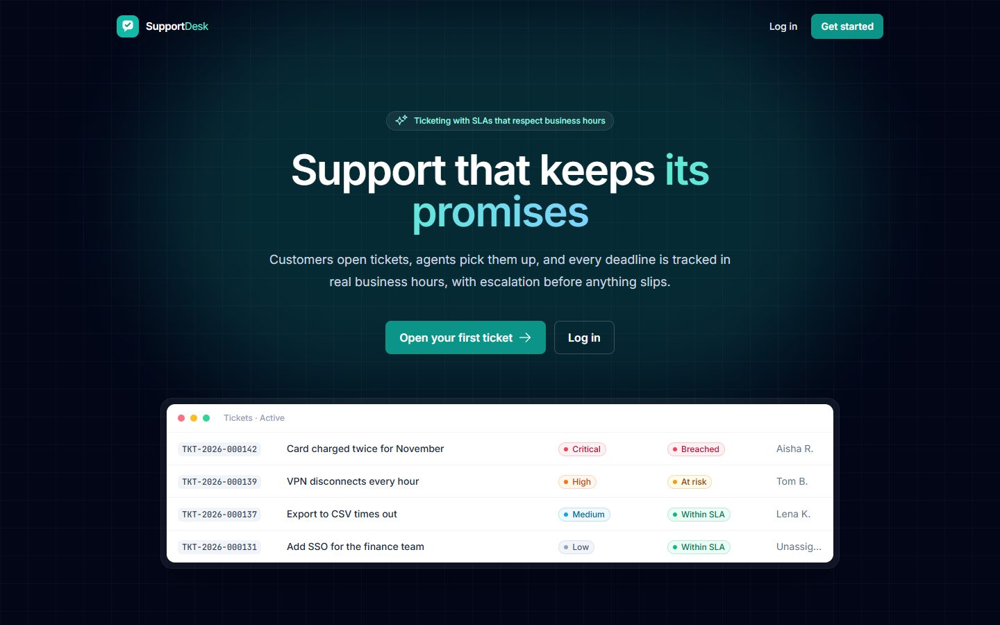

The public home page (`/`). It shows only the banner; the other sections are kept in a comment in
`resources/views/welcome.blade.php` for later. **Log in** goes to the sign-in page; **Get started** /
**Open your first ticket** creates a customer account.

The ticket table in the banner is an illustration, not real data.

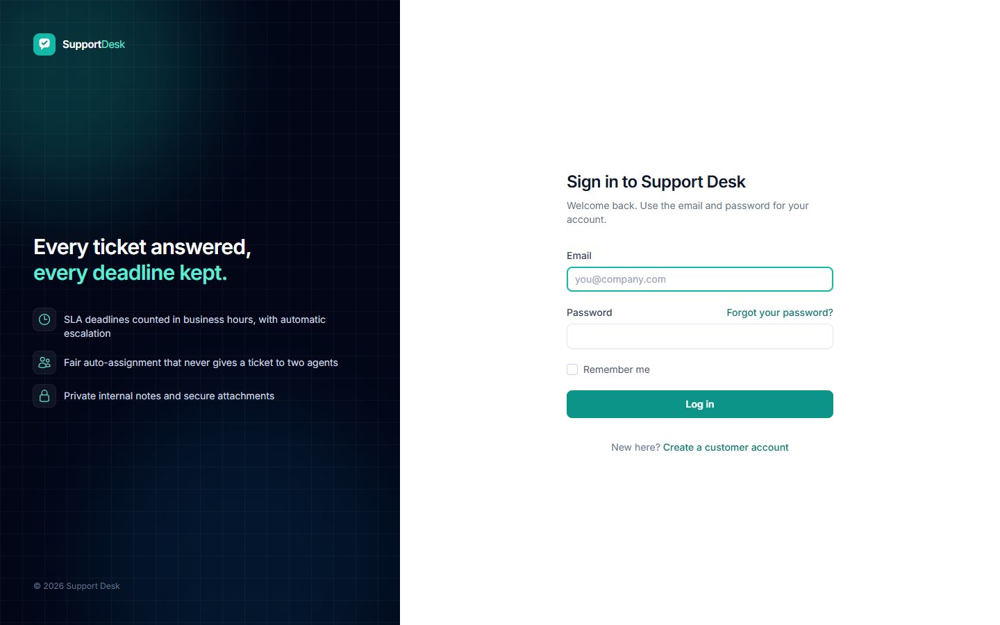

Sign in with an email and password from the table above. After signing in:

- customers land on **My tickets**;
- agents and admins land on the **Dashboard**.

New sign-ups are always customers. Staff accounts come from the seeder (there is no user-management screen).

---

## 3. The customer's view

The screens below are signed in as **Rashed Chowdhury**, a customer.

### My tickets

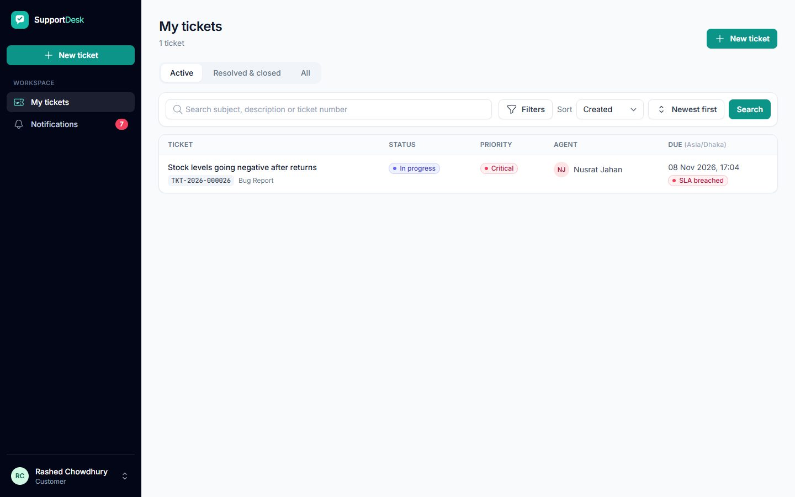

A customer sees **only their own tickets**. Rashed has one active ticket:

- **TKT-2026-000026**, "Stock levels going negative after returns": status *In progress*, priority *Critical*,
  handled by Nusrat Jahan, due 08 Nov 17:04, and shown as *SLA breached* because that deadline has passed.

The tabs at the top switch between **Active**, **Resolved & closed** and **All**. Search and filters work the
same way as for staff (section 5), minus the staff-only filters. Customers do not see the Customer column.

### Opening a ticket

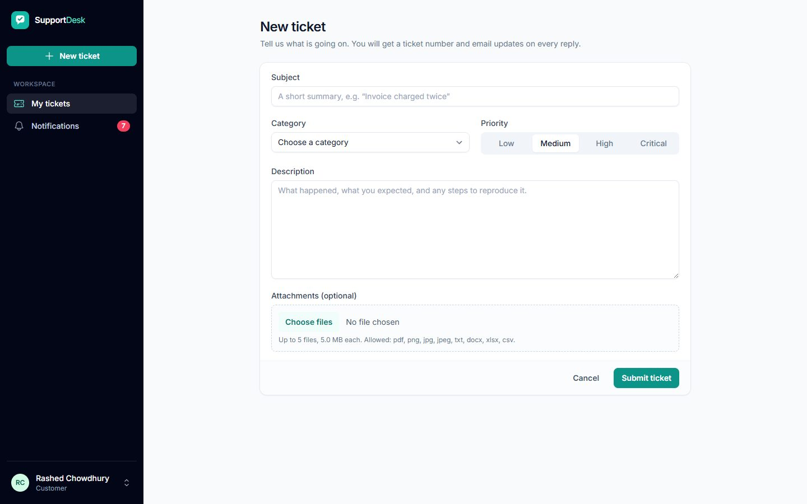

**New ticket** asks for:

| Field | Notes |
|---|---|
| Subject | Up to 255 characters |
| Category | Account & Login, Billing, Bug Report, Feature Request, General Inquiry, Technical Support |
| Priority | Low, Medium, High, Critical. It decides the deadline (section 8) |
| Description | What is going on |
| Attachments | Optional. Up to 5 files of 5 MB each: pdf, png, jpg, jpeg, txt, docx, xlsx, csv |

**Submit ticket** creates it at once and shows its number, for example `TKT-2026-000043`. Behind the scenes, the
deadline is calculated in business hours, the ticket goes to the best available agent, and the customer receives
a confirmation email.

### A ticket, as the customer sees it

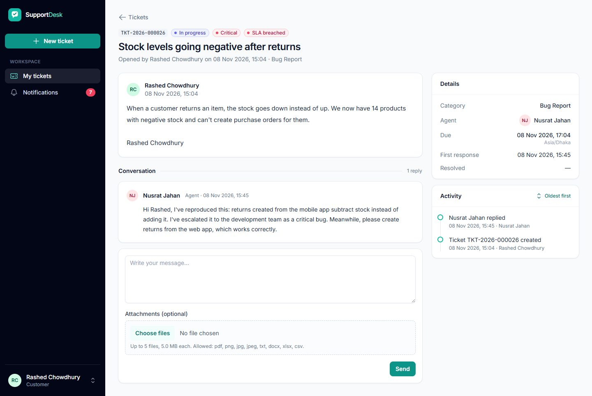

The same ticket, TKT-2026-000026, from Rashed's side:

- **Header:** number, status, priority and SLA badge, title, who opened it and when, category.
- **Original message** and the **conversation**: here, one reply from Nusrat Jahan.
- **Reply box** with optional attachments. A customer's reply always goes to the agent; customers cannot write
  internal notes.
- **Details:** category, agent, due date (in Asia/Dhaka time), first response, resolved.
- **Activity:** a short history of what happened.

> **What the customer does *not* see.** Compare this with the agent's view in section 4. Nusrat's
> **internal note** ("Mobile app v3.2 sends quantity with the wrong sign…") is missing here, and the activity
> list has only 2 entries instead of 8: internal staff steps (assignment, internal notes, SLA warnings, breaches
> and escalations) are hidden from customers. Internal notes never reach a customer: not on the page, in the
> JSON, in emails or in the timeline.

---

## 4. The agent's view

The screens below are signed in as **Nusrat Jahan**, an agent who specialises in technical support and bugs.

> **An agent sees only their own tickets.** The ticket list shows only tickets assigned to the agent, in every
> status (active, resolved and closed). Tickets nobody owns yet are in the **Unassigned queue**, where the agent
> can open them and accept them. A ticket assigned to another agent cannot be opened at all (section 4,
> "Someone else's ticket"). Admins still see everything.

### Dashboard

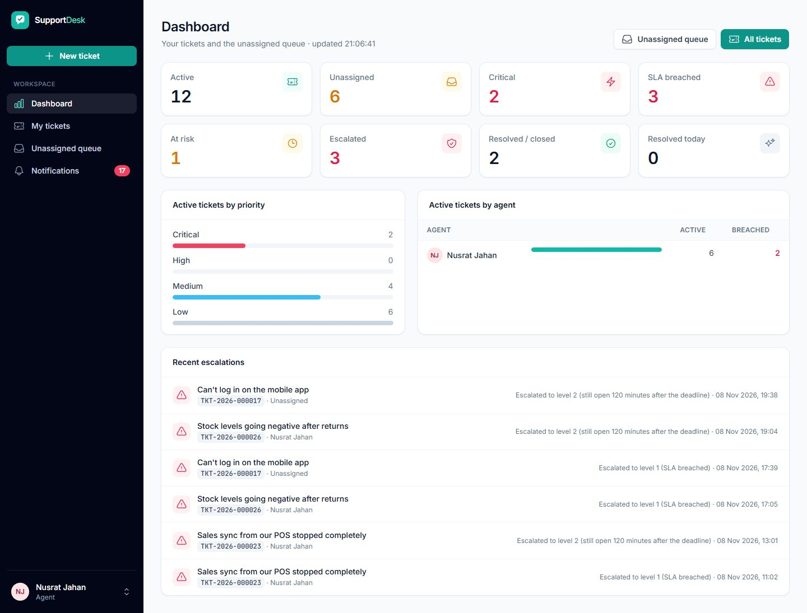

An agent's dashboard counts **their own tickets plus the unassigned queue**. Every card is a link to the filtered
ticket list behind the number.

| Card | Meaning | Nusrat's number |
|---|---|---|
| Active | Open, in progress or waiting for the customer | 12 |
| Unassigned | Nobody owns them yet | 6 |
| Critical | Active tickets with critical priority | 2 |
| SLA breached | Active and past their deadline | 3 |
| At risk | Past the warning time (80% of the target) but not yet due | 1 |
| Escalated | Breached tickets that were escalated | 3 |
| Resolved / closed | Finished tickets | 2 |
| Resolved today | Resolved since midnight | 0 |

Below the cards: active tickets by priority, Nusrat's load (6 active, 2 breached) and **Recent escalations**,
the newest SLA escalations with their ticket and time. The numbers refresh every 30 seconds.

### Unassigned queue

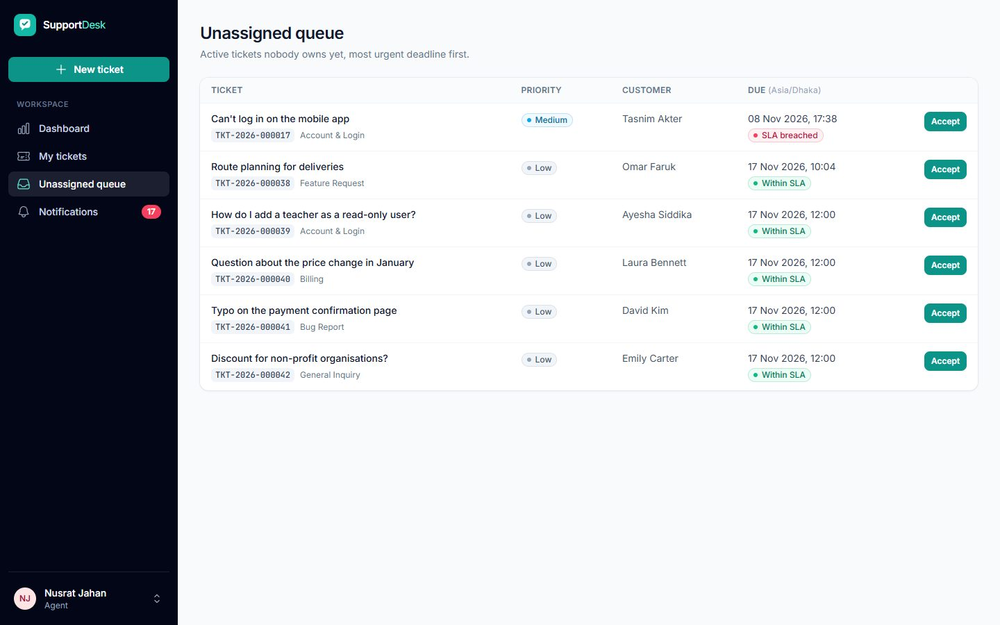

Active tickets that nobody owns, **most urgent deadline first**. The first one, "Can't log in on the mobile app"
(TKT-2026-000017), is already *SLA breached*. That is why it was escalated on the dashboard: an overdue,
unowned ticket.

**Accept** assigns the ticket to you. If two agents click Accept at the same moment, exactly one wins; the other
sees "This ticket was just taken by another agent." and nothing is overwritten.

Most new tickets never reach the queue: they are auto-assigned to the least busy suitable agent. A ticket stays
here when nobody suitable is available, and the system retries every 5 minutes.

### A ticket, as staff see it

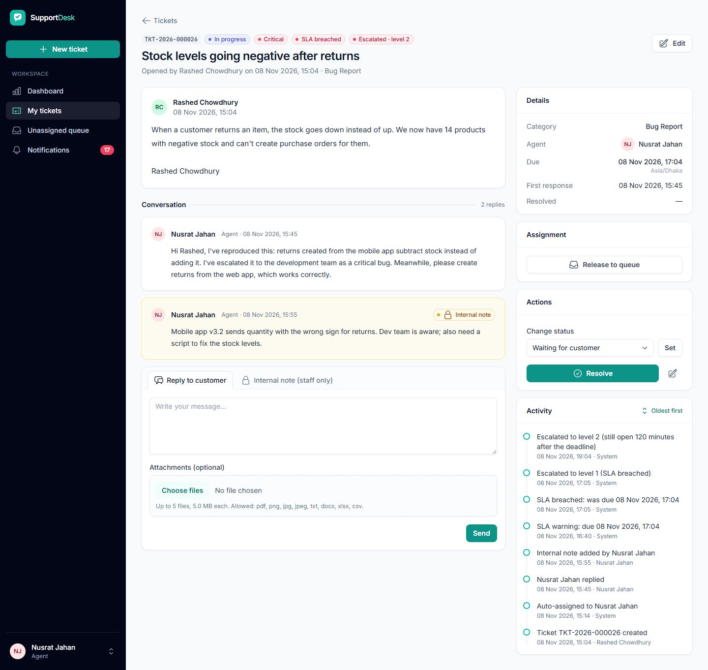

The same ticket as in section 3, now from Nusrat's side. What is extra for staff:

1. **Badges:** *Escalated · level 2* appears next to the status, priority and SLA badges. Level 1 is set when the
   deadline passes; level 2 when the ticket is still open 2 hours later.
2. **Internal note** (yellow, with a lock): visible to staff only.
3. **Reply box with two tabs:** *Reply to customer* (the customer is emailed) or *Internal note (staff only)*.
4. **Assignment:** *Release to queue* hands the ticket back. Admins also get a *Reassign to* dropdown.
5. **Actions:** change the status (*Waiting for customer*, *Open*…) and **Resolve**. The pencil icon adds an
   optional reason. Only moves that make sense are offered (section 8).
6. **Activity:** the full history, newest first (click *Oldest first* to flip it). For this ticket:

| Time (08 Nov) | Entry | By |
|---|---|---|
| 15:04 | Ticket TKT-2026-000026 created | Rashed Chowdhury |
| 15:14 | Auto-assigned to Nusrat Jahan | System |
| 15:45 | Nusrat Jahan replied | Nusrat Jahan |
| 15:55 | Internal note added by Nusrat Jahan | Nusrat Jahan |
| 16:40 | SLA warning: due 08 Nov 2026, 17:04 | System |
| 17:05 | SLA breached: was due 08 Nov 2026, 17:04 | System |
| 17:05 | Escalated to level 1 (SLA breached) | System |
| 19:04 | Escalated to level 2 (still open 120 minutes after the deadline) | System |

This is the audit trail from the specification: every important change, who made it and when. It cannot be
edited or deleted.

**Edit** (top right) changes the subject and description. Admins can also change priority and category; a priority
change recalculates the deadline.

### My tickets

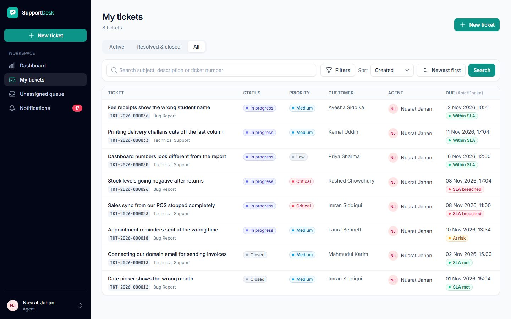

Nusrat's list, on the **All** tab: her 8 tickets, from the newest to her closed ones from last week. There are no
other agents' tickets and no unassigned ones; those wait in the queue. The **Agent** filter is gone for agents,
because the list is always their own.

### Someone else's ticket

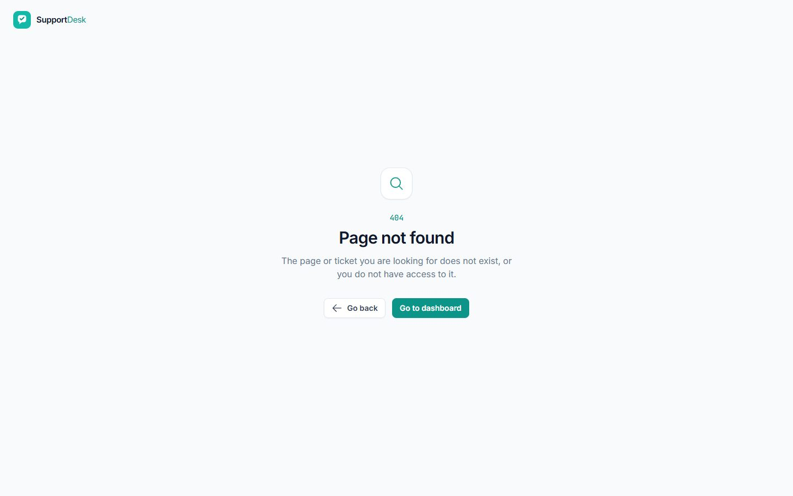

Opening a ticket that belongs to another agent (here Tanvir's TKT-2026-000019) shows **Page not found**, exactly
like a ticket number that doesn't exist, so an agent can't even tell whether that ticket is real. The same applies
to replying, editing or changing it.

### Notifications

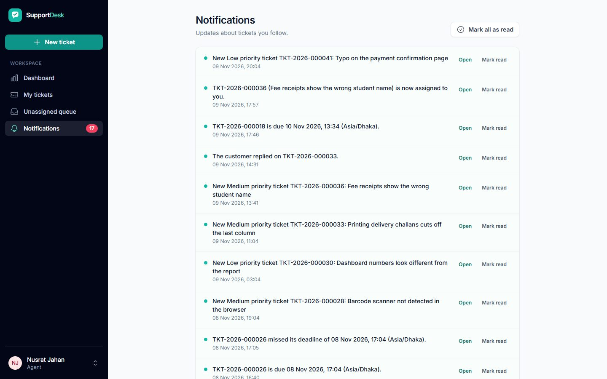

The bell in the sidebar shows unread notifications (17 for Nusrat). Each entry links to its ticket. Examples from
the sample data:

- "New Low priority ticket TKT-2026-000041: Typo on the payment confirmation page"
- "TKT-2026-000018 is due 10 Nov 2026, 13:34": an *at risk* warning
- "TKT-2026-000036 (Fee receipts show the wrong student name) is now assigned to you"
- "The customer replied on TKT-2026-000033"

**Mark read** handles one, **Mark all as read** handles all. The same events are also emailed. You are never
notified about something you did yourself.

### Profile and availability

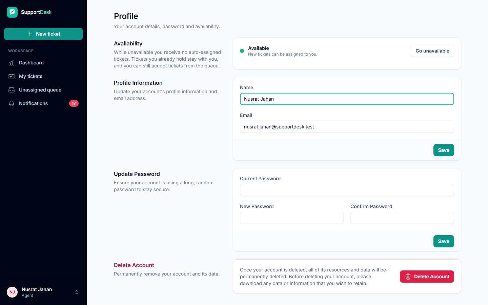

Agents have an **Availability** switch at the top of their profile. While **unavailable**, they receive no
auto-assigned tickets (useful for leave). They keep the tickets they hold and can still accept from the queue.
Everyone can also change their name, email and password here. Deleting an account works only for accounts with
no ticket history, because tickets and their audit trail must stay.

---

## 5. The admin's view

The screens below are signed in as **Farhana Haque**, the admin.

### Dashboard

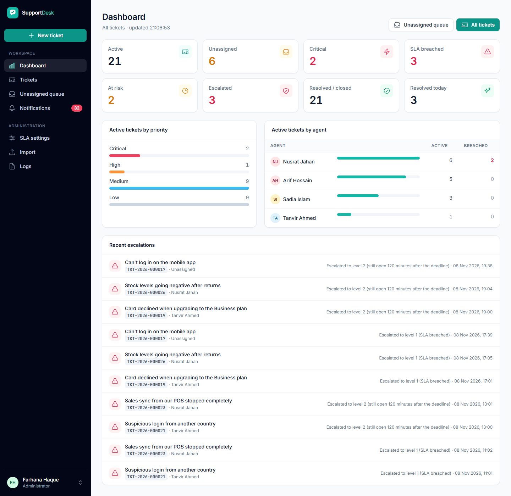

The same dashboard, but counting **every ticket**: 21 active, 6 unassigned, 2 critical, 3 SLA breached, 2 at
risk, 3 escalated, 21 resolved or closed, 3 resolved today.

**Active tickets by agent** shows each agent's load and how many of their tickets are breached:

| Agent | Active | Breached |
|---|---:|---:|
| Nusrat Jahan | 6 | 2 |
| Arif Hossain | 5 | 0 |
| Sadia Islam | 3 | 0 |
| Tanvir Ahmed | 1 | 0 |

Rakib Hasan is missing because he is on leave and holds no active tickets.

### All tickets

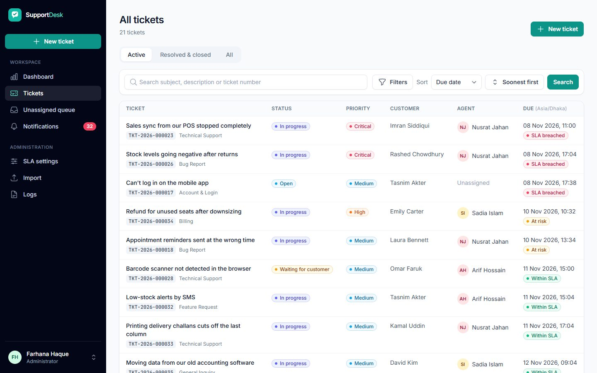

Admins see **all tickets** (agents see only their own), with a Customer column. On the Active tab, the default order is **due date, soonest
first**, so the most urgent work is at the top: the two breached critical tickets, then the rest.

How the list controls work:

| Control | What it does |
|---|---|
| **Tabs** | Active / Resolved & closed / All. Switching keeps your search and filters |
| **Search** | Words in the subject or description, or an exact ticket number (`TKT-2026-000026`) |
| **Filters** | Opens the filter panel; the badge shows how many filters are applied |
| **Sort** | Due date, Created, Last update or Priority |
| **Order button** | Says the current order ("Soonest first", "Newest first", "Highest first"); click to reverse it |

### Filters

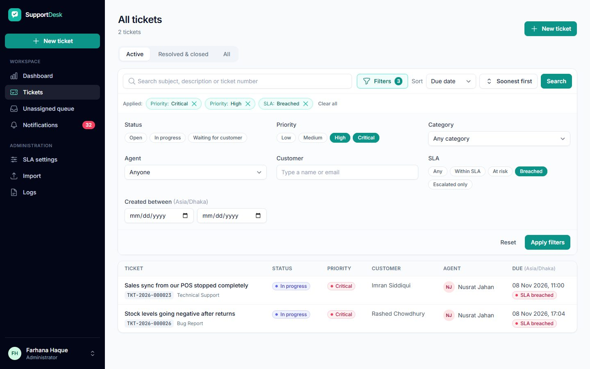

Here, three filters are applied: priority **Critical** and **High**, and SLA **Breached**. The result is the
2 tickets that need attention first.

- Applied filters appear as **chips** under the search box. Click **×** on a chip to remove just that filter, or
  **Clear all**.
- The panel offers: status (only the statuses of the current tab), priority, category, agent (including
  "Unassigned"), customer (type a name or email to search), SLA (within SLA, at risk, breached), *Escalated
  only*, and a created-date range.
- **Apply filters** runs the search; **Reset** clears the panel.
- Every filtered view is a normal link, so you can bookmark it or send it to a colleague.

### SLA settings

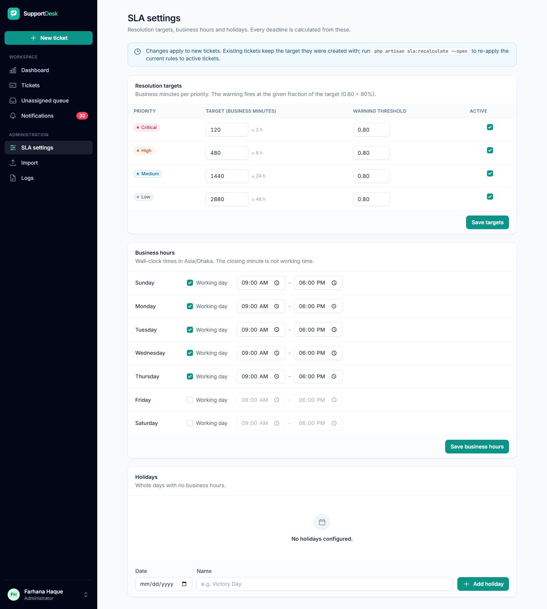

**Administration → SLA settings** controls every deadline:

- **Resolution targets** in business minutes per priority: critical 120 (≈ 2 h), high 480 (≈ 8 h),
  medium 1,440 (≈ 24 h), low 2,880 (≈ 48 h). The **warning threshold** (0.80) decides when a ticket becomes
  *at risk*: at 80% of its target.
- **Business hours** for each weekday. The sample setup is Sunday–Thursday, 09:00–18:00 (Asia/Dhaka); Friday
  and Saturday are closed.
- **Holidays**: whole days that do not count.

Deadlines count only business time. A critical ticket opened on Thursday at 17:00 gets 1 hour on Thursday and
the second hour on Sunday morning, so it is **due Sunday at 10:00**.

Changes apply to new tickets. Existing tickets keep their deadlines unless you run
`php artisan sla:recalculate --open`.

### CSV import

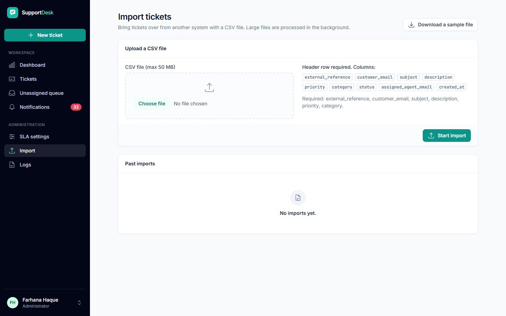

**Administration → Import** brings tickets over from another system:

1. **Download a sample file** to see the format.
2. Upload a CSV (max 50 MB) with a header row. Required columns: `external_reference`, `customer_email`,
   `subject`, `description`, `priority`, `category`. Optional: `status`, `assigned_agent_email`, `created_at`.
3. The import runs in the background (it needs a queue worker: `php artisan queue:work imports-database --queue=imports`).
   Its page shows live progress, and when it finishes you get a summary notification.
4. Rows with problems are skipped and listed with their row number; download them as a CSV, fix them and import
   them again. A row that was already imported is reported as a duplicate, never imported twice.

### Logs

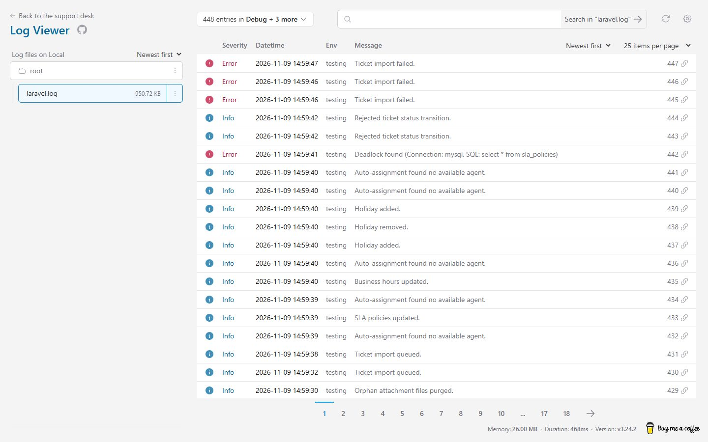

**Administration → Logs** opens the log viewer: the application's log file (`storage/logs/laravel.log`) with
every entry, its level (debug, info, warning, error…), time and message. You can search, filter by level,
expand an entry to see its details, and download the file. Only admins can open it.

---

## 6. On a phone

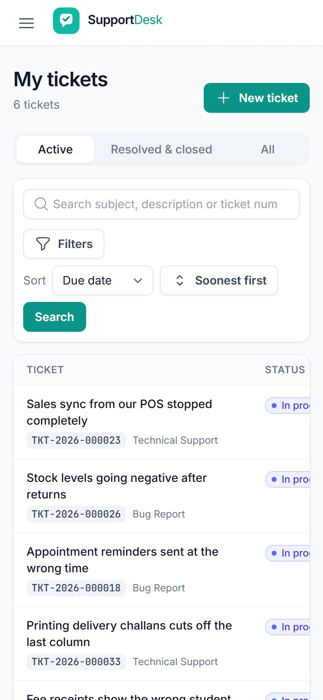

Every screen works on a phone. Here is Nusrat's **My tickets** on a phone: the sidebar folds into the ☰ menu at
the top left, the toolbar stacks, and tables scroll sideways inside their card.

---

## 7. A ticket's life, step by step

The sample ticket TKT-2026-000026 shows the normal flow, plus what happens when a deadline is missed:

1. **Customer opens it.** Rashed submits the form (critical, Bug Report). The ticket gets the next number, a
   deadline 2 business hours away (17:04) and a warning time at 80% of that (16:40). Rashed gets a receipt.
2. **It is assigned.** Ten minutes later the auto-assigner gives it to Nusrat, the least busy bug specialist.
   The status becomes *In progress*, and Nusrat and Rashed are notified.
3. **Agent replies.** Nusrat answers Rashed (he is emailed) and leaves an internal note for the team (he never
   sees it).
4. **Warning.** At 16:40 the ticket becomes *at risk*; Nusrat is notified.
5. **Breach and escalation.** At 17:04 the deadline passes: the ticket is *SLA breached* and escalated to
   level 1; Nusrat and every admin are notified. Two hours later it is still open, so it goes to level 2 and the
   admins are notified again.
6. **Next steps (not yet in the sample):**
   - The agent sets **Waiting for customer** while waiting for an answer. A customer reply moves it back to
     *In progress*.
   - The agent clicks **Resolve**, and the customer is notified.
   - If the problem comes back, the customer or the agent can **reopen** it (back to *In progress*, with a
     fresh deadline).
   - Three days after being resolved, the system **closes** it automatically.

Every step above is written to the ticket's Activity list.

---

## 8. Glossary: statuses, priorities, SLA badges

**Statuses**

| Status | Meaning | Can move to |
|---|---|---|
| Open | New, or back in the queue | In progress, Waiting for customer, Resolved |
| In progress | An agent is working on it | Waiting for customer, Resolved, Open |
| Waiting for customer | The agent needs an answer | In progress, Resolved, Closed, Open |
| Resolved | Fixed; closes automatically after 3 days | Closed, In progress (reopen) |
| Closed | Finished | In progress, by an admin only |

**Priorities and deadlines** (business time, editable in SLA settings)

| Priority | Target | Becomes *at risk* at |
|---|---|---|
| Critical | 2 hours | 96 minutes |
| High | 8 hours | 6 h 24 min |
| Medium | 24 hours | 19 h 12 min |
| Low | 48 hours | 38 h 24 min |

**SLA badges**

| Badge | Meaning |
|---|---|
| Within SLA (green) | Active and on time |
| At risk (amber) | Active, past the warning time, not yet due |
| SLA breached (red) | Active and past the deadline |
| Met / Missed | For finished tickets: resolved before or after the deadline |
| Escalated · level 1 / 2 | Breached; level 2 means still open 2 hours after the deadline |

All times are stored in UTC and shown in the business timezone (Asia/Dhaka).
